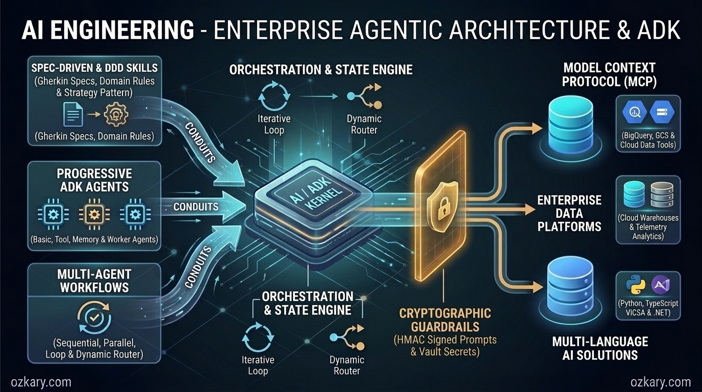

# AI Engineering: Enterprise Agentic Systems & Multi-Agent Architectures

Large Language Models (LLMs) and Autonomous AI Agents are transforming software engineering from static, imperative pipelines into dynamic, reasoning-driven systems. Modern enterprise AI requires more than basic prompt engineering—it demands **modular agent inheritance**, **cryptographic security guardrails**, **Domain-Driven Design (DDD) skills**, **Model Context Protocol (MCP)** tool integration, and **deterministic multi-agent workflows**.



### Announcement, Podcast & Updates
> 👉 **Watch the Podcast & Video Series:** [AI Bootcamp: Level Up Your Developer Skills (YouTube Playlist)](https://www.youtube.com/watch?v=OJjZGb7fmOo&list=PLU563hkqjVCkApIM979Qg4ICnXAFLeoL7)  
> 👉 **Read the Deep-Dive Articles:** [ozkary.com](https://www.ozkary.com) | **Join the Newsletter:** [Sign up here](https://www.ozkary.com/newsletter)  
> 👉 **Follow on Social:** [YouTube (@ozkary)](https://www.youtube.com/@ozkary) • [Twitter / X (@ozkary)](https://twitter.com/ozkary)  

---

## 🎯 What Can This Repository Help With?

This repository serves as a comprehensive engineering blueprint and hands-on catalog for building production-grade AI applications and autonomous agents. Every module is paired with technical deep-dive articles on **[ozkary.com](https://www.ozkary.com)** and video walkthroughs from the **[AI Bootcamp YouTube Series](https://www.youtube.com/watch?v=OJjZGb7fmOo&list=PLU563hkqjVCkApIM979Qg4ICnXAFLeoL7)**:

- **Google ADK Multi-Agent Systems ([`/adk`](./adk/)):** A complete, step-by-step curriculum and reference architecture demonstrating object-oriented agent reuse, MCP data warehouse integration (BigQuery, GCS, Snowflake), supply-chain prompt security, DDD skills, and multi-agent graph orchestration.
- **Framework & Graph Orchestration ([`/ai-agents`](./ai-agents/)):** Stateful autonomous agents built with **LangChain**, **LangGraph**, and **Google Gemini** for real-time telemetry and Statistical Process Control (SPC).
- **AI-Driven Software Architecture ([`/typescript`](./typescript/)):** Repository-driven AI governance and strict **Separation of Concerns (SoC)** using the **React ViCSA Pattern**.
- **Applied AI Use Cases ([`/use_cases`](./use_cases/), [`/python`](./python/), [`/csharp`](./csharp/)):** Practical implementations of code generation from Agile user stories, AI-powered Smart Charts, and prompt engineering across Python, TypeScript, and .NET.

---

## 🤖 Google ADK (Agent Development Kit) Solutions Catalog

Our flagship agentic engineering suite lives in the **[`/adk`](./adk/)** directory. Instead of treating AI agents as isolated, throwaway scripts, this architecture enforces **Software Engineering Reusability (DRY)**, **Spec-Driven Development (SDD)**, and **Repository-Driven AI Governance** through a progressive inheritance hierarchy.

### 🏗️ Core Architectural Pillars

* **Progressive Inheritance & Reusability:** Every agent extends a shared [`BaseAgent`](./adk/core/base_agent.py) foundation—progressively layering identity, MCP tools, persistent memory, cryptographic guardrails, domain skills, and multi-agent workflow graphs without duplicating boilerplate.
* **Model Context Protocol (MCP):** Decouples model reasoning from cloud data platforms (`BigQueryToolset`, `GCSToolset`, and Snowflake stubs) via standardized tool interfaces.
* **Cryptographic Security Guardrails:** Protects autonomous agents against supply-chain prompt injection and semantic hijacking using **HMAC-SHA256 signed prompts (`.signed.md`)**, **GCP Secret Manager vault integration**, and pre-tool execution hooks.
* **Domain-Driven Skills & Strategy Pattern Commands:** Separates semantic domain knowledge (`SKILL.md`) from deterministic data warehouse execution strategies (`commands/`).
* **Spec-Driven Development (SDD):** System requirements and behavioral guardrails are validated through human-readable Markdown specifications and executable **Gherkin (`.feature`)** test suites.

### 📂 Progressive ADK Agent Catalog

Each entry below links directly to the agent folder in [`/adk`](./adk/), its flagship article on **[ozkary.com](https://www.ozkary.com)**, and its **[AI Bootcamp YouTube video](https://www.youtube.com/watch?v=OJjZGb7fmOo&list=PLU563hkqjVCkApIM979Qg4ICnXAFLeoL7)**:

| Stage | Agent Solution Folder | Class & Inheritance | Capabilities & Architectural Focus | 🎥 Video & 📄 Article (`ozkary.com`) |
| :--- | :--- | :--- | :--- | :--- |
| **0. Foundation** | **[`adk/core`](./adk/core/)** | [`BaseAgent`](./adk/core/base_agent.py) | Central configuration loader, environment variable resolution, and base ADK runtime contract. | [🎥 Watch Video](https://www.youtube.com/watch?v=ND-qYhXTsN4&list=PLU563hkqjVCkApIM979Qg4ICnXAFLeoL7)<br>[📄 Article](https://www.ozkary.com/2026/06/building-reusable-extendable-agents-with-the-google-adk.html) |
| **1. Identity** | **[`adk/basic_agent`](./adk/basic_agent/)** | [`BasicAgent`](./adk/basic_agent/agent.py) `← BaseAgent` | Stateless conversational persona, environment-driven system instructions, and baseline Gemini reasoning. | [🎥 Watch Video](https://www.youtube.com/watch?v=ND-qYhXTsN4&list=PLU563hkqjVCkApIM979Qg4ICnXAFLeoL7)<br>[📄 Article](https://www.ozkary.com/2026/06/building-reusable-extendable-agents-with-the-google-adk.html) |
| **2. Tool Loop** | **[`adk/tool_agent`](./adk/tool_agent/)** | [`ToolAgent`](./adk/tool_agent/agent.py) `← BasicAgent` | Action & interaction loop equipped with **Google Cloud Storage (`GCSToolset`)** and **BigQuery MCP (`BigQueryToolset`)** toolsets. | [🎥 Watch Video](https://www.youtube.com/watch?v=opelf_XJ8Js&list=PLU563hkqjVCkApIM979Qg4ICnXAFLeoL7)<br>[📄 Article](https://www.ozkary.com/2026/04/architecting-an-agentic-data-pipeline-from-data-lake-discovery-to-managed-orchestration.html) |
| **3. Continuity** | **[`adk/memory_agent`](./adk/memory_agent/)** | [`MemoryAgent`](./adk/memory_agent/agent.py) `← ToolAgent` | Stateful session continuity and conversational memory persistence backed by SQLite (`SqliteSessionService`). | [🎥 Watch Video](https://www.youtube.com/watch?v=ND-qYhXTsN4&list=PLU563hkqjVCkApIM979Qg4ICnXAFLeoL7)<br>[📄 Article](https://www.ozkary.com/2026/06/building-reusable-extendable-agents-with-the-google-adk.html) |
| **4. Red-Team Sim** | **[`adk/dark_agent`](./adk/dark_agent/)** | [`DarkAgent`](./adk/dark_agent/agent.py) `← BasicAgent` | Adversarial agent simulating a supply-chain prompt injection exploit and semantic hijacking. | [🎥 Watch Video](https://www.youtube.com/watch?v=JUbGHkzbkHw&list=PLU563hkqjVCkApIM979Qg4ICnXAFLeoL7)<br>[📄 Article](https://www.ozkary.com/2026/08/the-dark-side-of-autonomous-agents.html)<br>[📘 Local Guide](./adk/DARK-AGENT.md) |
| **5. Hardened Security** | **[`adk/secured_agent`](./adk/secured_agent/)** | [`SecuredToolAgent`](./adk/secured_agent/agent.py) `← ToolAgent` | Enforces **HMAC-SHA256 prompt signature verification**, prompt quarantine/recovery, GCP Secret Manager lookup, and pre-tool security hooks. | [🎥 Watch Video](https://www.youtube.com/watch?v=JUbGHkzbkHw&list=PLU563hkqjVCkApIM979Qg4ICnXAFLeoL7)<br>[📄Article](https://www.ozkary.com/2026/08/the-dark-side-of-autonomous-agents.html)<br>[📘 Security Plan](./adk/security_architecture_plan.md) |
| **6. DDD Skills** | **[`adk/skill_agent`](./adk/skill_agent/)** | [`SkillAgent`](./adk/skill_agent/agent.py) `← SecuredToolAgent` | Domain-agnostic execution kernel dynamically mounting **DDD Skills** (`mta`, `factory_telemetry`, `bq`) and **Strategy Pattern Commands** across BigQuery & Snowflake. | [🎥 Watch Video](https://www.youtube.com/watch?v=o_En8fzuUvo&list=PLU563hkqjVCkApIM979Qg4ICnXAFLeoL7)<br>[📄  Article](https://www.ozkary.com/2026/09/beyond-the-persona-master-skills-and-commands.html)<br>[📘 Local Guide](./adk/SKILL-AGENT.md) |
| **7. Worker Node** | **[`adk/worker_agent`](./adk/worker_agent/)** | [`WorkerAgent`](./adk/worker_agent/agent.py) `← BaseAgent` | Lightweight sub-agent abstraction encapsulating `name`, `instruction`, `tools`, and `output_key` for multi-agent workflow graphs. | [🎥 Watch Video](https://www.youtube.com/watch?v=ArDL2vEXnuA&list=PLU563hkqjVCkApIM979Qg4ICnXAFLeoL7)<br>[📘 Workflow Guide](./adk/workflow_agent/README.md)<br>[📄 Article](https://www.ozkary.com/2026/11/smart-orchestration-multi-agent-systems-workflows.html) |
| **8. Orchestration** | **[`adk/workflow_agent`](./adk/workflow_agent/)** | [`WorkflowAgent`](./adk/workflow_agent/agent.py) `← SecuredToolAgent` | Multi-agent orchestration suite implementing **Sequential**, **Parallel**, **Loop**, and **Custom Dynamic Router** workflows for NYC Transit Geo-Zone analytics. | [🎥 Watch Video](https://www.youtube.com/live/ArDL2vEXnuA?si=5SsV8A6VKJQYErUh)<br>[📘 Workflow Guide](./adk/workflow_agent/README.md) • [📐 Specs](./adk/workflow_agent/specs.md)<br>[📄 Article ](https://www.ozkary.com/2026/11/smart-orchestration-multi-agent-systems-workflows.html) |

### 🧩 Supporting ADK Infrastructure Modules

| Module Folder | Purpose | 🎥 Video & 📄 Article (`ozkary.com`) |
| :--- | :--- | :--- |
| **[`adk/skills`](./adk/skills/)** | Domain-Driven Design (DDD) semantic layers (`SKILL.md` & YAML configs) for **[MTA Transit](./adk/skills/mta/)**, **[Geo-Fencing](./adk/skills/geo_fencing/)**, **[Factory Telemetry](./adk/skills/factory_telemetry/)**, **[Data Discovery](./adk/skills/data_discovery/)**, and **[BigQuery](./adk/skills/bq/)**. | [🎥 Beyond the Persona](https://www.youtube.com/watch?v=o_En8fzuUvo&list=PLU563hkqjVCkApIM979Qg4ICnXAFLeoL7)<br>[📄 Article](https://www.ozkary.com/2026/09/beyond-the-persona-master-skills-and-commands.html) |
| **[`adk/commands`](./adk/commands/)** | Deterministic `FunctionTool` command conduits implementing the Strategy Pattern across **[BigQuery](./adk/commands/bq/)**, **[GCS](./adk/commands/gcs/)**, and **[Snowflake](./adk/commands/snowflake/)**. | [🎥 Beyond the Persona](https://www.youtube.com/watch?v=o_En8fzuUvo&list=PLU563hkqjVCkApIM979Qg4ICnXAFLeoL7)<br>[📄 Article](https://www.ozkary.com/2026/09/beyond-the-persona-master-skills-and-commands.html) |
| **[`adk/tools`](./adk/tools/)** | Shared MCP and native toolsets for **[BigQuery](./adk/tools/bq/)**, **[Google Cloud Storage](./adk/tools/gcs/)**, and **[Snowflake](./adk/tools/snowflake/)**. | [🎥 Agentic Data Pipeline](https://www.youtube.com/watch?v=opelf_XJ8Js&list=PLU563hkqjVCkApIM979Qg4ICnXAFLeoL7)<br>[📄 Article](https://www.ozkary.com/2026/04/architecting-an-agentic-data-pipeline-from-data-lake-discovery-to-managed-orchestration.html) |
| **[`adk/security`](./adk/security/)** | Cryptographic manifest verifier ([`manifest_verifier.py`](./adk/security/manifest_verifier.py)), GCP Vault secret manager ([`secure_auth.py`](./adk/security/secure_auth.py)), and pre-tool guardrails ([`hook_files.py`](./adk/security/hook_files.py), [`hook_bq.py`](./adk/security/hook_bq.py)). | [🎥 Dark Side of Agents](https://www.youtube.com/watch?v=JUbGHkzbkHw&list=PLU563hkqjVCkApIM979Qg4ICnXAFLeoL7)<br>[📄 Article](https://www.ozkary.com/2026/08/the-dark-side-of-autonomous-agents.html) |
| **[`adk/specs`](./adk/specs/)** | Executable **Gherkin BDD feature files** ([`adk/specs/features/`](./adk/specs/features/)) and architectural gap analyses. | [🎥 Beyond the Prompt (SDD)](https://www.youtube.com/watch?v=Bk9y4nS4RL8&list=PLU563hkqjVCkApIM979Qg4ICnXAFLeoL7)<br>[📄 Article](https://www.ozkary.com/2026/07/beyond-the-prompt-building-enterprise-solutions-with-ai-specification-driven-design.html) |
| **[`adk/workflows`](./adk/workflow_agent/)** | Workflow design patterns | [🎥 Smart Orchestration](https://www.youtube.com/watch?v=Bk9y4nS4RL8&list=PLU563hkqjVCkApIM979Qg4ICnXAFLeoL7)<br>[📄 Article](https://www.ozkary.com/2026/07/beyond-the-prompt-building-enterprise-solutions-with-ai-specification-driven-design.html) |


👉 **Explore the full ADK Bootstrap Guide:** **[`adk/README.md`](./adk/README.md)** • **[`adk/DEMO-RUNBOOK.md`](./adk/DEMO-RUNBOOK.md)**

---

## 🌐 Cross-Framework Agents, Architectures & Use Cases Catalog

Beyond the Google ADK suite, this repository includes specialized implementations across **LangChain**, **LangGraph**, **React/TypeScript**, **Python**, and **C# (.NET)**:

| Category | Solution Folder | Technologies | Description | 🎥 Video & 📄 Article (`ozkary.com`) |
| :--- | :--- | :--- | :--- | :--- |
| **Autonomous Agents** | **[`ai-agents/manufacturing`](./ai-agents/manufacturing/)** | Python, LangChain, LangGraph, Gemini | Stateful Control Chart Analyst agent that monitors manufacturing telemetry, detects Statistical Process Control (SPC) violations, and recommends corrective actions. ([Overview](./ai-agents/README.md)) | [🎥 Active Agents Video](https://www.youtube.com/watch?v=oJC8XhxvdX4&list=PLU563hkqjVCkApIM979Qg4ICnXAFLeoL7)<br>[📄 Active Agents Article](https://www.ozkary.com/2026/05/from-passive-dashboards-to-active-agents-real-time-reasoning-over-data-streams.html)<br>[📄 AI Agent Primer](https://www.ozkary.com/2025/06/autonomous-ai-agent-primers-guide.html) |
| **AI Governance & Architecture** | **[`typescript/architecture`](./typescript/architecture/)** | React, TypeScript, ViCSA Pattern | Implements strict **Separation of Concerns (View, Controller, Service, API)** in vertical slices to enable predictable **Repository-Driven AI Governance** and automated code auditing. | [🎥 AI Architecture Video](https://www.youtube.com/watch?v=wvhb9B3DeMY&list=PLU563hkqjVCkApIM979Qg4ICnXAFLeoL7)<br>[📄 Article](https://www.ozkary.com/2026/02/ai-driven-architecture-smart-development-life-cycle-governance.html) |
| **Smart Charts & Analytics** | **[`use_cases/smart_charts`](./use_cases/smart_charts/)**<br>**[`python/smart_charts`](./python/smart_charts/)** | Python, Jupyter, Gemini, OpenAI | Enhances data visualization with AI-driven pattern detection, correlation analysis, control limit evaluation, and automated narrative storytelling. | [🎥 Smart Charts Video](https://www.youtube.com/watch?v=gSCYAl8vS44&list=PLU563hkqjVCkApIM979Qg4ICnXAFLeoL7)<br>[📄 Article](https://www.ozkary.com/2025/01/smart-charts-powered-by-ai-to-enhance-data-understanding.html) |
| **Code Generation** | **[`use_cases/code_generation`](./use_cases/code_generation/)**<br>**[`python/code_generation`](./python/code_generation/)**<br>**[`csharp/CodeGeneration`](./csharp/CodeGeneration/)** | Python, C# (.NET), Azure OpenAI, Gemini, GitHub API | Generates production code snippets and functions directly from structured Agile user stories and technical specifications. | [🎥 Code Gen Video](https://www.youtube.com/watch?v=QsX5ylDx4gM&list=PLU563hkqjVCkApIM979Qg4ICnXAFLeoL7)<br>[📄 GitHub User Stories](https://www.ozkary.com/2024/04/generative-ai-create-code-from-github-user-stories-large-language-models.html)<br>[📄 Azure OpenAI C#](https://www.ozkary.com/2023/06/azure-openai-api-service-with-csharp.html) |
| **Prompt Engineering** | **[`python/prompt_engineering`](./python/prompt_engineering/)** | Python, OpenAI, Gemini | Patterns and notebooks for designing, structuring, and optimizing few-shot and context-rich prompts for data analysis. | [📄 Master Prompting](https://www.ozkary.com/2026/10/master-prompting-for-data-analysis-practical-patterns.html) |
| **Shared Cloud Services** | **[`python/services`](./python/services/)** | Python, Gemini, OpenAI, GitHub | Reusable service wrappers for **[Gemini](./python/services/gemini/)**, **[OpenAI](./python/services/openai/)**, and **[GitHub](./python/services/github/)** integrations. | [📄 ozkary.com Blog](https://www.ozkary.com) |

---

## 🛡️ AI Governance, Security & Compliance

* **AI Governance:** Establishes architectural policies, cryptographic prompt verification, pre-tool execution hooks, and declarative routing ([`adk/config/routing.yaml`](./adk/config/routing.yaml)) so autonomous agents operate within strict, auditable boundaries.
* **AI Compliance:** Ensures agent workflows adhere to enterprise data protection standards, schema contracts, and least-privilege secret management via vault-backed authentication rather than exposed plaintext environment variables.

---

## 🛠️ Environment Setup & Centralized Installation

To eliminate dependency version conflicts and ensure fast, reproducible execution, the workspace runtime is managed using **`uv`** at the repository root.

### Prerequisites
Ensure you have the Rust-backed Python package manager **`uv`** installed globally:

```bash
# Install uv globally (macOS/Linux)
curl -LsSf https://astral.sh/uv/install.sh | sh

# Install uv globally (Windows PowerShell)
powershell -ExecutionPolicy ByPass -c "irm https://astral.sh/uv/install.ps1 | iex"
```

### Quick Start Installation

```bash
# 1. Clone the repository and navigate to the root directory
git clone https://github.com/ozkary/ai-engineering.git
cd ai-engineering

# 2. Initialize Python 3.12 and synchronize the unified virtual environment
make setup
```

### Launching the ADK Agents Interactively (`adk web`)

Navigate into the [`adk`](./adk/) directory and use the Makefile shortcuts to launch any individual agent sandbox or the entire multi-agent catalog in the interactive ADK Web UI:

```bash
cd adk

# Launch progressive foundational agents
make run-basic      # Step 1: Basic persona agent
make run-tool       # Step 2: GCS & BigQuery MCP tool agent
make run-memory     # Step 3: SQLite persistent memory agent

# Launch security, domain skill, and multi-agent workflow suites
make run-dark       # Step 4: Adversarial supply-chain exploit simulation
make run-skill      # Step 6: Domain-Driven Skill & Strategy Pattern agent
make run-workflow   # Step 8: Multi-Agent Workflow Orchestrator (Sequential, Parallel, Loop, Router)

# Or load all ADK agents simultaneously in the web harness
make run-all
```
