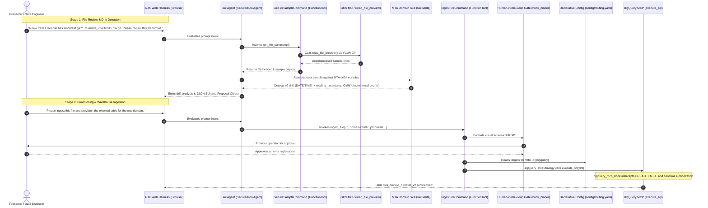

# Demo Runbook: Skill Agent & MTA Turnstile Schema Drift (v1 to v2)

## Architectural Context & Reference Pipeline
This demo directly builds upon the production data lakehouse architecture defined in:
👉 **[ozkary/data-engineering-mta-turnstile](https://github.com/ozkary/data-engineering-mta-turnstile)**

### Storage & Lakehouse Baseline
- **GCP Project**: `ozkary-de-101`
- **GCS Data Lake Bucket**: `gs://ozkary_data_lake_ozkary-de-101/`
- **Baseline v1 Feed (Historical 2024 Data)**:
  - **Folder**: `turnstile/`
  - **File Format**: `YYMMDD.csv.gz` (e.g., `gs://ozkary_data_lake_ozkary-de-101/turnstile/240915.csv.gz`)
  - **Warehouse Status**: External table **`mta_dev.ext_turnstile`** is already provisioned and operational in BigQuery.
  - **Legacy Schema**: 11 columns with fragmented `DATE` (`MM/DD/YYYY`) and `TIME` (`HH:MM:SS`), and cumulative mechanical register counters (`C/A`, `UNIT`, `SCP`, `STATION`, `LINENAME`, `DIVISION`, `DATE`, `TIME`, `DESC`, `ENTRIES`, `EXITS`).

### The Demo Trigger: Arrival of Modernized v2 Feed
- **Folder**: `turnstile_v2/`
- **File Format**: `YYMMDD.csv.gz` (e.g., `gs://ozkary_data_lake_ozkary-de-101/turnstile_v2/240915.csv.gz`)
- **The Event**: A new file lands in `turnstile_v2/` with the same `YYMMDD.csv.gz` naming convention, but containing a modernized payload with **breaking schema drift**.
- **The Challenge**: We cannot overwrite `mta_dev.ext_turnstile` or allow an unvetted schema to break downstream pipelines.
- **The Solution**: 
  - [`SkillAgent`](adk/skill_agent/agent.py) extends [`SecuredToolAgent`](adk/secured_agent/agent.py) as an agnostic kernel.
  - Commands ([`get_file_sample`](adk/commands/gcs/get_file_sample.py) and [`ingest_file`](adk/commands/gcs/process_file.py)) are registered as tools on the agent.
  - The agent inspects raw payloads via GCS MCP (`read_file_preview`), applies domain heuristics from [`skills/mta/SKILL.md`](adk/skills/mta/SKILL.md), halts for Human-in-the-Loop (HITL) approval, and provisions **`mta_dev.ext_turnstile_v2`** via MCP toolsets with zero raw client instances.

---

## 1. Architectural Blueprint: Connecting Skills, Commands, and Tools

```text
Agent (SkillAgent extends SecuredToolAgent)
├── tools = [ ...GCS MCP, BQ MCP, security tools..., get_file_sample, ingest_file ]  ← Commands live here as tools
├── skills = [ mta/SKILL.md, bq/SKILL.md ]                                           ← Injected via constructor
└── before_tool_callback = [ guardrail_pre_tool_hook, bigquery_mcp_hook ]            ← Inherited from SecuredToolAgent
```

### Where Each Layer Sits
- **How do I inspect the data?** $\rightarrow$ **Inspection Command** ([`get_file_sample`](adk/commands/gcs/get_file_sample.py) calling GCS MCP [`read_file_preview`](adk/tools/gcs/server.py)).
- **What does this file mean?** $\rightarrow$ **Skill** (Domain Judgment: schema drift heuristics, v1 vs v2 in [`skills/mta/SKILL.md`](adk/skills/mta/SKILL.md)).
- **Where does this domain land?** $\rightarrow$ **`config/routing.yaml`** (Declarative Configuration).
- **How do I provision the warehouse?** $\rightarrow$ **Provisioning Command & Strategy** ([`ingest_file`](adk/commands/gcs/process_file.py) dispatching DDL rendering for BigQuery & Snowflake).
- **Am I allowed to write there?** $\rightarrow$ **Hook** (Security Enforcement: [`bigquery_mcp_hook`](adk/security/hook_bq.py) on `execute_sql`).

---

## 2. Pre-Flight Setup & Launching the Web UI

### 2.1 Environment Configuration
Ensure Vertex AI and GCP credentials are configured in your local environment or `.env`:
```bash
export GOOGLE_APPLICATION_CREDENTIALS="/home/ozkary/.gcp/ozkary-de-101.json"
export GOOGLE_CLOUD_PROJECT="ozkary-de-101"
export GOOGLE_GENAI_USE_VERTEXAI="1"
export GOOGLE_CLOUD_LOCATION="us-east1"
export LLM_MODEL="gemini-2.5-flash"
```

### 2.2 Launch the ADK Web Harness
Run the make target from the workspace root:
```bash
make run-skill
```
*(Equivalent command: `uv run adk web skill_agent/`)*

### 2.3 Access the UI
Open your browser to:
**`http://127.0.0.1:8000`** *(or the port displayed in your terminal)*

Select **`skill_agent`** from the agent selector dropdown.

---

## 3. Interactive Assistant CLI Demo Playbook (Chat Assistant Execution)

> [!TIP]
> **Presenter Shortcut**: Instead of running through the browser web harness, you can execute the entire live demo interactively by prompting the AI coding assistant directly in chat. If you start a fresh chat session, simply instruct:
> *"Follow the interactive demo playbook in DEMO-RUNBOOK.md"*

### Assistant Execution Rules
> [!IMPORTANT]
> **Strict Operational Guardrails for the Assistant**:
> 1. **Zero File/Environment Scanning**: Do **NOT** search the filesystem (`find`, `ls`), scan project directories, inspect extraneous code, or query environment variables. The repo and environment are pre-configured.
> 2. **Direct CLI Launch**: Immediately start the process by running the designated `uv run adk run skill_agent/ ...` command via shell.
> 3. **Stream Agent Feedback**: Present the agent's inspection, drift analysis, and proposed schema contract directly back to the user in chat.
> 4. **Mandatory User HITL Prompt**: Do **NOT** auto-approve on the user's behalf. Halt and explicitly prompt the user for their Human-in-the-Loop decision (`yes`/`no`) before provisioning.
> 5. **Complete the Ingestion Process**: Upon receiving operator approval (`yes`), dispatch the ingestion command with the confirmed input, display the rendered DDL and BigQuery execution output, and confirm external table creation.

---

### Step-by-Step Interactive Flow

#### **Step 1: Inspect Payload & Detect Schema Drift**
* **Trigger Prompt**:
  ```text
  Run file review for gs://ozkary_data_lake_ozkary-de-101/turnstile_v2/240915.csv.gz
  ```
  *(or triggered automatically when asked to follow the interactive demo)*
* **Assistant Action**:
  * Immediately runs:
    ```bash
    uv run adk run skill_agent/ "A new transit feed file has landed at gs://ozkary_data_lake_ozkary-de-101/turnstile_v2/240915.csv.gz. Please review this file format."
    ```
  * Displays the agent feedback directly to the user:
    * Raw payload sample lines.
    * Domain skill reasoning flagging breaking drift (`reading_timestamp`, `fare_method`, normalized `booth_id`, discrete incremental counts).
    * Structured JSON Schema Proposal Object.

#### **Step 2: Prompt User for HITL Approval & Provision Table**
* **Trigger / Flow**:
  * Assistant displays the drift comparison and prompts the user:
    > **"👉 Do you approve registering this schema and creating tables? (yes/no)"**
  * When user confirms (`yes` or prompt: `Approve and provision table for mta domain`):
* **Assistant Action**:
  * Runs the ingestion pipeline passing operator confirmation to stdin:
    ```bash
    printf "yes\n" | uv run adk run skill_agent/ "Please ingest the file gs://ozkary_data_lake_ozkary-de-101/turnstile_v2/240915.csv.gz and provision the external table for the mta domain."
    ```
  * **Feedback Presentation**: Display the live agent execution output directly back to the user in a terminal code block, ensuring the following key milestones are presented:
    1. **Schema Proposal & Drift Diff**: The HITL guardrail comparison highlighting baseline v1 vs. modernized v2 breaking changes and inferred column schema.
    2. **Generated DDL**: The rendered BigQuery `CREATE OR REPLACE EXTERNAL TABLE` statement targeting `ext_turnstile_v2` with the `*.csv.gz` wildcard URI pattern.
    3. **Execution Results & Agent Response**: The BigQuery MCP execution status and the final `[skill_agent]` response confirming external table provisioning.
  * *(If the user responds `no`, halt execution and report that schema registration was rejected by the operator).*

#### **Step 3: Reset Demo Environment (Teardown)**
* **Trigger Prompt**:
  ```text
  Reset demo environment
  ```
* **Assistant Action**:
  * Drops `ozkary-de-101.mta_dev.ext_turnstile_v2` via `bq rm -f -t ozkary-de-101:mta_dev.ext_turnstile_v2` to return BigQuery to the baseline state.

---

## 4. Live Demo Script & Step-by-Step Flow (Web Harness Alternative)



---

### Step 1: Set the Stage (Existing Pipeline Baseline)
**Talking Point**:
> *"In our production data lake `gs://ozkary_data_lake_ozkary-de-101/`, our data warehouse already has an established external table `mta_dev.ext_turnstile` reading legacy 2024 turnstile logs from the `turnstile/` folder using files named `YYMMDD.csv.gz`."*
>
> *"Today, a new file arrives under a modernized folder: `turnstile_v2/240915.csv.gz`. It follows the exact same filename format, but the data inside has shifted. Rather than maintaining a brittle monolithic agent persona, we invoke our agnostic Skill Agent. Notice that the agent carries zero hardcoded domain skills or commands — both are injected via Dependency Injection."*

---

### Step 2: Ask the Agent to Review the New File Format
In the ADK Web chat prompt, enter:

#### 💬 Prompt to Copy/Paste:
```text
A new transit feed file has landed at gs://ozkary_data_lake_ozkary-de-101/turnstile_v2/240915.csv.gz.
Please review this file format.
```

*(Local fallback equivalent if running offline simulation)*:
```text
A new transit feed file has landed at data/turnstile_v2/240915.csv.gz.
Please review this file format.
```

---

### Step 3: Highlight File Inspection via GCS MCP & Domain Reasoning
**What happens live**:
1. **Tool Selection**: The LLM recognizes the need to inspect storage and calls the injected GCS command:
   `get_file_sample(uri="gs://ozkary_data_lake_ozkary-de-101/turnstile_v2/240915.csv.gz")`.
2. **MCP Retrieval**:
   - The command delegates to the GCS MCP tool ([`read_file_preview`](adk/tools/gcs/server.py)) to decompress and read the header and top rows.
3. **Domain Evaluation**: The agent evaluates the returned preview against the mounted domain skill ([`skills/mta/SKILL.md`](adk/skills/mta/SKILL.md)):
   - **Temporal Consolidation**: Flags that legacy `DATE` (`MM/DD/YYYY`) and `TIME` (`HH:MM:SS`) columns are gone, replaced by unified `reading_timestamp` mapped to `TIMESTAMP`.
   - **Normalized Identifier**: Detects that legacy `C/A` has been normalized to `booth_id`.
   - **Dimensional Expansion**: Detects the new `fare_method` dimension (contactless OMNY taps).
   - **Counter Semantics**: Detects incremental counts (`entry_count`, `exit_count`) rather than cumulative mechanical registers.
4. **Structured Proposal (No Code Generation)**: The agent outputs a clear drift summary and the **JSON Schema Proposal Object**:

```json
{
  "domain": "mta_transit",
  "detected_version": "v2",
  "baseline_version": "v1",
  "breaking_drift_detected": true,
  "drift_summary": [
    "Consolidated separate DATE and TIME text columns into unified TIMESTAMP reading_timestamp",
    "Normalized C/A column to booth_id",
    "Introduced new dimensional attribute fare_method for contactless OMNY taps",
    "Transitioned from cumulative register counts to discrete incremental batch volumes"
  ],
  "format": "CSV",
  "delimiter": ",",
  "skip_leading_rows": 1,
  "columns": [
    {"name": "station_id", "type": "STRING", "mode": "REQUIRED", "description": "MTA station complex ID"},
    {"name": "booth_id", "type": "STRING", "mode": "REQUIRED", "description": "Control area booth ID (formerly C/A)"},
    {"name": "reading_timestamp", "type": "TIMESTAMP", "mode": "REQUIRED", "description": "Unified event timestamp"},
    {"name": "fare_method", "type": "STRING", "mode": "NULLABLE", "description": "Payment type (OMNY or MetroCard)"},
    {"name": "entry_count", "type": "INT64", "mode": "REQUIRED", "description": "Incremental turnstile entry count"},
    {"name": "exit_count", "type": "INT64", "mode": "REQUIRED", "description": "Incremental turnstile exit count"}
  ]
}
```

---

### Step 4: Trigger Ingestion & Provisioning
In the ADK Web chat prompt, enter:

#### 💬 Prompt to Copy/Paste:
```text
Looks good. Please ingest this file and provision the external table for the mta domain.
```

**What happens live**:
1. The agent invokes `ingest_file(uri="gs://ozkary_data_lake_ozkary-de-101/turnstile_v2/240915.csv.gz", domain="mta", proposal=...)`.
2. Because `breaking_drift_detected: true` was flagged, the command triggers the Human-in-the-Loop (HITL) guardrail.

---

### Step 5: The Human-in-the-Loop (HITL) Guardrail Gate
**Talking Point**:
> *"Because `breaking_drift_detected: true` was triggered, the command invokes our pre-mutation guardrail (`hook_binder.py`). Before any warehouse table is created or modified, an operator reviews the visual schema diff."*

Show the drift diff display:

```text
====================================================================
🛡️  [HITL GUARDRAIL] SCHEMA DRIFT DETECTED: MTA_TRANSIT FEED
====================================================================
Detected Version:  v2  |  Baseline Version: v1
Breaking Drift:    ⚠️  YES (Requires Operator Sign-off)

Schema Drift Comparison (Baseline v1 vs Modernized v2):
  • Consolidated separate DATE and TIME text columns into unified TIMESTAMP reading_timestamp
  • Normalized C/A column to booth_id
  • Introduced new dimensional attribute fare_method for contactless OMNY taps
  • Transitioned from cumulative register counts to discrete incremental batch volumes

Target Inferred Schema Contract:
  • station_id             STRING         [REQUIRED] -- MTA station complex ID
  • booth_id               STRING         [REQUIRED] -- Control area booth ID (formerly C/A)
  • reading_timestamp      TIMESTAMP      [REQUIRED] -- Unified event timestamp
  • fare_method            STRING         [NULLABLE] -- Payment type (OMNY or MetroCard)
  • entry_count            INT64          [REQUIRED] -- Incremental turnstile entry count
  • exit_count             INT64          [REQUIRED] -- Incremental turnstile exit count

Planned Warehouse Targets:
  • BigQuery:  mta_dev.ext_turnstile_v2 (Partitioned by _PARTITIONDATE)
====================================================================
```

---

### Step 6: Declarative Routing & MCP Tool Execution
**Talking Point**:
> *"Once the operator signs off, the command looks up target warehouses in `config/routing.yaml`. Notice that the LLM never picks a warehouse; that is governed by configuration. The command dispatches to the BigQuery strategy and calls the BigQuery MCP tool `execute_sql`."*

#### Target BigQuery DDL:
```sql
CREATE OR REPLACE EXTERNAL TABLE `ozkary-de-101.mta_dev.ext_turnstile_v2`
(
  `station_id` STRING NOT NULL OPTIONS(description="MTA station complex ID"),
  `booth_id` STRING NOT NULL OPTIONS(description="Control area booth ID (formerly C/A)"),
  `reading_timestamp` TIMESTAMP NOT NULL OPTIONS(description="Unified event timestamp"),
  `fare_method` STRING OPTIONS(description="Payment type (OMNY or MetroCard)"),
  `entry_count` INT64 NOT NULL OPTIONS(description="Incremental turnstile entry count"),
  `exit_count` INT64 NOT NULL OPTIONS(description="Incremental turnstile exit count")
)
OPTIONS (
  format = 'CSV',
  uris = ['gs://ozkary_data_lake_ozkary-de-101/turnstile_v2/*.csv.gz'],
  skip_leading_rows = 1
);
```

#### Pre-Tool Hook Interception:
When `execute_sql` is invoked with this DDL, [`bigquery_mcp_hook`](adk/security/hook_bq.py) (inherited from `SecuredToolAgent`) inspects the query, detects `CREATE EXTERNAL TABLE`, and validates permissions before execution.

---

### Step 7: Zero-Code Fan-Out Demo (BigQuery + Snowflake)
**Talking Point**:
> *"What if our data platform needs to fan-out this dataset to both Google BigQuery and Snowflake Data Cloud? In a legacy agent, you would have to rewrite prompts or agent code. Here, it is a single line change in `config/routing.yaml`:"*

Show `config/routing.yaml`:
```yaml
domains:
  mta:
    targets:
      - bigquery
      - snowflake       # Added Snowflake fan-out!
    primary: bigquery
```

The command automatically dispatches to [`SnowflakeTableStrategy`](adk/commands/snowflake/create_external_table.py), which renders native Snowflake stage expressions:
```sql
CREATE OR REPLACE EXTERNAL TABLE MTA_DB.RAW_STAGING.EXT_MTA_TURNSTILE_V2
(
  station_id            VARCHAR         AS ($1:c1::VARCHAR) COMMENT 'MTA station complex ID',
  booth_id              VARCHAR         AS ($1:c2::VARCHAR) COMMENT 'Control area booth ID (formerly C/A)',
  reading_timestamp     TIMESTAMP_NTZ   AS ($1:c3::TIMESTAMP_NTZ) COMMENT 'Unified event timestamp',
  fare_method           VARCHAR         AS ($1:c4::VARCHAR) COMMENT 'Payment type (OMNY or MetroCard)',
  entry_count           NUMBER(38,0)    AS ($1:c5::NUMBER(38,0)) COMMENT 'Incremental turnstile entry count',
  exit_count            NUMBER(38,0)    AS ($1:c6::NUMBER(38,0)) COMMENT 'Incremental turnstile exit count',
  _ingested_at          TIMESTAMP_NTZ   AS CURRENT_TIMESTAMP()
)
LOCATION = @MTA_GCS_STAGE/turnstile_v2/
FILE_FORMAT = (
  TYPE = 'CSV'
  SKIP_HEADER = 1
  FIELD_DELIMITER = ','
  EMPTY_FIELD_AS_NULL = TRUE
);
```
*(Execution routes cleanly to [`SnowflakeToolset`](adk/tools/snowflake/toolset.py) stub, proving cross-cloud warehouse portability).*

---

### Step 8: The Learning Loop (Fast Path vs. Judgment Path)

#### 8.1 Architectural Context: Two-Tier Memory Architecture
The agent system intentionally separates memory into two distinct operational tiers:
1. **Operational / Pipeline Memory ([`SchemaRegistry`](file:///home/ozkary/workspace/chat-gpt/adk/commands/gcs/process_file.py#L25-L48))**:
   - Implemented in [`commands/gcs/process_file.py`](file:///home/ozkary/workspace/chat-gpt/adk/commands/gcs/process_file.py).
   - Generates a deterministic SHA-256 fingerprint from the raw file header line (`hashlib.sha256(first_line)`).
   - Caches the approved schema proposal object once signed off by an operator.
   - Prevents context bloat, token burn, and prompt drift by running known schemas deterministically in code.
2. **Conversational Session Memory ([`PersistentSessionManager`](file:///home/ozkary/workspace/chat-gpt/adk/tools/session.py#L19-L56) / [`DatabaseSessionService`](file:///home/ozkary/workspace/chat-gpt/adk/core/runner.py#L69-L84))**:
   - Persisted to SQLite (`data/mta_pipeline_memory.db`) via ADK session services.
   - Tracks conversational chat turns, user messages, and multi-turn context across agent interactions.

#### 8.2 The Fast Path vs. Judgment Path Lifecycle

```mermaid
flowchart TD
    subgraph Turn1 ["Turn 1: September Feed (240915.csv.gz) - Judgment Path"]
        A1["Arrives at turnstile_v2/"] --> B1["Inspect Sample via GCS MCP"]
        B1 --> C1["Query SchemaRegistry Cache"]
        C1 -->|"Cache Miss (Unknown)"| D1["🧠 Judgment Path: Skill Drift Analysis"]
        D1 --> E1["🛡️ HITL Gate: Human Approves Diff"]
        E1 --> F1["Register SHA-256 Signature in Cache"]
        F1 --> G1["Provision mta_dev.ext_turnstile_v2"]
    end

    subgraph Turn2 ["Turn 2: November Feed (241115.csv.gz) - Fast Path"]
        A2["Arrives at turnstile_v2/"] --> B2["Inspect Sample via GCS MCP"]
        B2 --> C2{"Check SchemaRegistry"}
        C2 -->|"Hit (Signature Matched)"| D2["⚡ Fast Path: 0 LLM Tokens"]
        D2 --> E2["Bypass HITL & Direct Strategy Execution"]
        E2 --> F2["Instant Table / Partition Sync"]
    end
```



---

#### 8.3 Live Demo Action: Test the Fast Path
In the ADK Web chat prompt, feed a subsequent monthly payload with the same modernized format:

##### 💬 Prompt to Copy/Paste:
```text
A subsequent transit feed file has landed at gs://ozkary_data_lake_ozkary-de-101/turnstile_v2/241115.csv.gz.
Please ingest this file for the mta domain.
```

*(Local fallback equivalent if running offline simulation)*:
```text
A subsequent transit feed file has landed at data/turnstile_v2/241115.csv.gz.
Please ingest this file for the mta domain.
```

#### 8.4 What Happens Live
1. **Tool Invocation**: The agent calls [`ingest_file(uri=".../turnstile_v2/241115.csv.gz", domain="mta")`](file:///home/ozkary/workspace/chat-gpt/adk/commands/gcs/process_file.py#L84-L215).
2. **Signature Matching**: [`SchemaRegistry.get_signature_key()`](file:///home/ozkary/workspace/chat-gpt/adk/commands/gcs/process_file.py#L30-L33) samples the header:
   ```text
   station_id,booth_id,reading_timestamp,fare_method,entry_count,exit_count
   ```
3. **Cache Hit**: [`SchemaRegistry.get()`](file:///home/ozkary/workspace/chat-gpt/adk/commands/gcs/process_file.py#L35-L37) matches the signature registered during Step 5.
4. **Wire-Speed Execution**:
   - The command emits:
     ```text
     ⚡ [FAST PATH] Schema signature cached (<sig_key>). Zero LLM tokens consumed!
     ```
   - **Bypasses LLM Reasoning**: Zero tokens spent re-evaluating column types or drift heuristics.
   - **Bypasses HITL Gate**: Operator sign-off is skipped because this exact schema contract was already approved.
   - **Direct Strategy Dispatch**: Dispatches straight to [`BigQueryTableStrategy.create_external_table()`](file:///home/ozkary/workspace/chat-gpt/adk/commands/bq/create_external_table.py#L71-L105) and [`SnowflakeTableStrategy.create_external_table()`](file:///home/ozkary/workspace/chat-gpt/adk/commands/snowflake/create_external_table.py#L86-L115).

#### 8.5 Speaker Talking Points:
> *"Notice what just occurred: In Turn 1 with `240915.csv.gz`, the agent hit the **Judgment Path**. Because the schema had never been seen before, it engaged the MTA domain skill, identified the breaking schema drift, and paused at the HITL gate for our sign-off."*
>
> *"Once approved, the command cached the SHA-256 header signature in [`SchemaRegistry`](file:///home/ozkary/workspace/chat-gpt/adk/commands/gcs/process_file.py#L25-L48). When November's batch (`241115.csv.gz`) arrived, it executed via the **Fast Path**—bypassing LLM inference, skipping operator approval, and executing at wire speed with **zero LLM tokens consumed**."*
>
> *"In production lakehouses handling thousands of files a day, this architecture ensures AI is only invoked when genuine anomalies or schema collisions occur—not for mechanical data processing."*

#### 8.6 Production Scaling Note:
In this demo harness, [`SchemaRegistry._cache`](file:///home/ozkary/workspace/chat-gpt/adk/commands/gcs/process_file.py#L28) is held in the running process memory. In enterprise production, this backing store plugs directly into Redis, Cloud Memorystore, or a Lakehouse Metastore (e.g., Dataplex or BigQuery Metadata), allowing multiple distributed agent workers to share the learned schema contract across pods and restarts.

---

## 4. Demo Talking Points & FAQ Reference

| Question | Speaker Response |
| :--- | :--- |
| **Why not update the existing `mta_dev.ext_turnstile` table?** | Modernized v2 feeds have breaking schema drift (removed columns, unified timestamps, incremental volume). Updating `ext_turnstile` in-place would immediately break all downstream views (`vw_turnstile`), dbt models, and BI dashboards built on top of v1. The skill agent detects this and safely provisions `ext_turnstile_v2`. |
| **Why separate `get_file_sample` from `ingest_file`?** | Single Responsibility Principle. File inspection via GCS MCP is an exploratory command that returns content for LLM reasoning against mounted skills. Table ingestion is a mutation command that takes a validated proposal, applies HITL gates, and dispatches DDL via warehouse MCP toolsets. |
| **Why use MCP tools instead of raw Python client libraries?** | Using MCP toolsets standardizes database connectivity and allows pre-tool hooks (`bigquery_mcp_hook`) to centrally guard against destructive SQL (`DROP`, `DELETE`) and mandate Human-in-the-Loop authorization on `CREATE TABLE`. |
| **Why is routing in YAML instead of an environment variable or LLM prompt?** | Target warehouse selection is a governance/deployment decision, not model judgment. An env var cannot easily express fan-out or per-domain differences without custom string parsing. Declarative YAML is auditable, supports multiple targets, and allows hooks to enforce target allowlists. |
| **How does this prevent prompt injection?** | Domain skills are stored in [`skills/mta/SKILL.md`](skills/mta/SKILL.md) with an accompanying `SKILL.signed.md` HMAC-SHA256 signature verified against GCP Secret Manager. The agent cannot mount untrusted or modified prompts. |
| **Why is offline fallback logic strictly forbidden?** | Offline heuristic guessers create dual-engine maintenance drift. If the LLM reasoning fails, the pipeline halts immediately with an explicit error rather than silently provisioning bad schemas in production. |

## Presentation & Meetup Guide

### Session Title: Beyond the Persona — Mastering Agent Skills and Commands

#### Overview
Your agent's persona was never meant to carry your entire domain knowledge. As teams bring AI into real data engineering workflows—handling shifting ingestion feeds, inferring schemas, and standardizing lakehouse partitions—a single system instructions file quickly becomes a tangled mess of identity, procedure, and governance. It becomes hard to reuse, hard to reason about, and impossible to trust in production data pipelines.

The fix is simpler than it sounds: **skills teach an agent what it knows, commands give it something it can do.** Everything else follows from that distinction. A deterministic data pipeline command executes predictable steps automatically, invoking an AI skill only when genuine judgment is required—like when an unfamiliar data payload arrives with an unmapped schema that threatens established tables.

In this practical, pattern-driven session, we will take a monolithic data agent and refactor it into an enterprise-grade modular system:
- **Commands** orchestrate predictable ingestion steps end-to-end without wasting LLM tokens.
- **Skills** step in dynamically to infer unknown schemas, evaluate breaking drift, and draft structured contracts.
- **Hooks & Guardrails** gate sensitive mutations—enforcing human sign-off before raw data reaches staging buckets or analytical tables, and remembering the approved schema so future batches run at wire speed.

Whether you are an aspiring engineer curious about production AI or a seasoned developer scaling data infrastructure, you'll walk away with an architectural blueprint to build agents that are maintainable, auditable, and production-ready.

---

### Presentation Agenda (6-Slide Structure)

#### Slide 1: The Monolith Agent — The Real-World Ingestion Problem
- **The Common Starting Point**: Building a data agent the usual way—one massive instructions file trying to juggle agent identity, domain heuristics, SQL DDL standards, and security policies.
- **The Production Breaking Point**: An established pipeline running smoothly on known data suddenly encounters an unexpected feed change with breaking schema drift.
- **Why Monoliths Break Data Pipelines**: Context bloat, tight coupling, hallucinated DDL risks, and the danger of an autonomous agent corrupting established analytical tables and downstream dashboards.

#### Slide 2: Demystifying Agent Skills — Teaching Domain Judgment (What It Knows)
- **Purpose (What is an Agent Skill?)**: A modular, reusable package of domain intelligence, vocabulary, and validation rules. Instead of hardcoding all world knowledge into a single prompt, a skill equips the agent with specific domain expertise on demand.
- **Why Use Skills?**:
  - Eliminates monolithic prompt tangles and context bloat.
  - Keeps the core agent persona lightweight, reusable, and domain-agnostic.
  - Enforces a strict contract boundary: skills evaluate data and emit validated JSON schema contracts—they *never* generate raw, risky SQL scripts or code.
  - Enables domain logic to be versioned, tested, and shared across different agents.
- **How Skills Are Loaded (Grounding with Design Patterns)**:
  - **Inversion of Control (IoC) & Dynamic Mounting**: The host agent carries zero static domain logic; skills are dynamically injected and mounted into the agent's context envelope only when summoned.
  - **Domain-Driven Design (DDD)**: Skills are organized into isolated *Bounded Contexts* (e.g., transit telemetry vs. factory IoT vs. lakehouse governance), preventing cross-domain contamination.
  - **Integrity Verification**: Cryptographically verifying skill assets at load time to prevent prompt injection and unauthorized modification.

#### Slide 3: Demystifying Agent Commands — Deterministic Execution (What It Does)
- **Purpose (What is an Agent Command?)**: A self-contained, deterministic workflow that performs concrete, predictable pipeline actions in code (such as previewing storage blobs, verifying cache signatures, and dispatching DDL). Commands represent what the agent can *do*.
- **Why Use Commands?**:
  - Deterministic reliability: routine, predictable pipeline steps should run as proven code, not prompt guesses.
  - Zero token waste: mechanical tasks (cache lookups, file reads, template rendering) execute at wire speed with zero LLM overhead.
  - Clear separation of concerns: the LLM skill provides the semantic *judgment* ("what does this data mean?"), while the command handles the *execution* ("how do we ingest it?").
- **How Commands Are Loaded (Grounding with Design Patterns)**:
  - **Tools Interface (Callable Tools)**: Commands are registered directly as callable tools on the agent, using standard function docstrings so the agent knows when to invoke them.
  - **The Strategy Pattern**: The command decouples the schema contract from the underlying cloud technology. A single validated schema proposal can dispatch to different warehouse strategies (e.g., BigQuery vs. Snowflake) via configuration without modifying agent code.
  - **Security Interceptor Hooks**: Command execution is intercepted by pre-tool hooks to validate permissions and enforce safety before any database mutation occurs.

#### Slide 4: Managing Schema Drift — When Skills and Commands Collaborate
- **The Reality of Established Tables**: In production, established analytical tables and downstream dashboards already exist. You cannot allow an agent to silently overwrite or break them when a source format shifts.
- **The Judgment Path (AI on Demand)**: When an unfamiliar feed arrives, the command detects a cache miss and invokes the agent's domain skill to analyze differences, identify breaking column drift, and draft a modernized schema proposal.
- **Human-in-the-Loop (HITL) Guardrails**: A deterministic hook halts execution before any table is created or modified, presenting engineers with a clear visual diff between the established baseline and the proposed contract for sign-off.
- **The Fast Path & The Learning Loop**: Why spend AI tokens on data formats you've already seen? Once approved, the command caches the schema fingerprint. Subsequent batches process deterministically at wire speed with **zero LLM tokens**.

#### Slide 5: Live Demonstration — From Shifting Feeds to Lakehouse Provisioning
- **Step-by-Step Live Walkthrough**:
  - **Drift Detection**: Watching the agent inspect an unmapped incoming feed, apply domain skills to detect breaking schema drift against an established baseline, and emit a structured contract.
  - **The HITL Guardrail Gate**: Intercepting the pending mutation and prompting the operator with a visual schema diff comparison for review and approval.
  - **Multi-Warehouse Provisioning**: Dispatched execution provisioning the modernized analytical table dynamically.
  - **Zero-Code Fan-Out**: Demonstrating warehouse portability by routing to multiple target cloud data warehouses through configuration alone.
  - **The Fast Path in Action**: Feeding subsequent data batches through the pipeline to witness instant, zero-token execution at wire speed.

#### Slide 6: Key Takeaways & The Road Ahead
- **The Agent-Skill-Command Mental Model**:
  - *Agent* = The agnostic orchestration host.
  - *Skill* = What it knows (domain judgment, business heuristics, contracts).
  - *Command* = What it does (deterministic execution, strategies, tools).
- **Engineering Over Prompting**: How classical software engineering patterns (IoC, Strategy, Bounded Contexts) turn experimental prototypes into robust, cost-effective production systems.
- **The Road Ahead**: Safe extensibility without touching the core runtime engine, scaling from single modular agents to distributed agent meshes, and automated schema CI/CD pipelines.