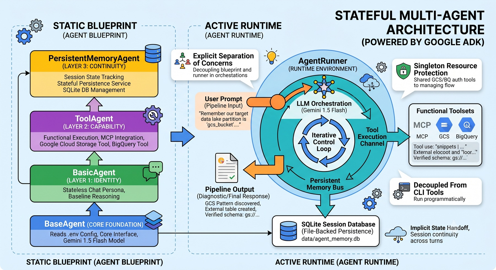

# AI Agents with Google ADK: Technical Bootstrap Blueprint

Welcome to the foundational training ground and enterprise reference architecture for the **Google Agent Development Kit (ADK)**. If you have ever looked at production-grade agentic frameworks and felt overwhelmed by massive abstractions, complex multi-agent synchronization code, or brittle state loops, this project is designed for you. 

This directory provides a **progressive, step-by-step curriculum** focused on building confidence with intelligent software systems using the native **Google ADK**. 

> 🎥 **Podcast & Video Series:** [AI Bootcamp: Level Up Your Developer Skills (YouTube Playlist)](https://www.youtube.com/watch?v=OJjZGb7fmOo&list=PLU563hkqjVCkApIM979Qg4ICnXAFLeoL7)  
> 📄 **Flagship Articles & Tutorials:** [ozkary.com](https://www.ozkary.com)

---

## 🧭 Educational Philosophy: Progressive Evolution & True Reusability

Our core mission is to introduce you to the Google ADK starting with its **basic core concepts** and progressively evolving your agents' capabilities through clean object-oriented inheritance.

A major flaw in many Python-based AI tutorials is that they treat agents as throwaway scripts, leading to massive code duplication. This project rejects that pattern by focusing heavily on **Software Engineering Reusability (DRY)**, **Cryptographic Security Guardrails**, **Domain-Driven Design (DDD) Skills**, and **Multi-Agent Workflow Orchestration**.



By leveraging Python's module system alongside the Google ADK's fluid configuration layer, you will see how to build enterprise-ready agents that are modular, extensible, and auditable.

---

## 🏗️ Project Architecture & Agent Catalog

This workspace consolidates its package management at the root level while keeping individual agent directories self-contained with their own isolated local runtime parameters.

```text
adk/
│
├── core/                     # STEP 0: Core Foundation (BaseAgent)
│   └── base_agent.py         # Central env configuration & ADK Agent builder contract
│
├── basic_agent/              # STEP 1: Core Fundamentals (Model + Instructions)
│   ├── .env                  # Sandbox environment keys & credentials
│   └── agent.py              # Extends BaseAgent with stateless persona & instructions
│
├── tool_agent/               # STEP 2: The Action Loop (MCP & Cloud Tools)
│   ├── .env                  # Sandbox environment keys & credentials
│   └── agent.py              # Extends BasicAgent; attaches GCS & BigQuery MCP toolsets
│
├── memory_agent/             # STEP 3: Stateful Continuity (Persistent Memory)
│   ├── .env                  # Sandbox environment keys & credentials
│   └── agent.py              # Extends ToolAgent; integrates SQLite session persistence
│
├── dark_agent/               # STEP 4: Adversarial Exploit Simulation (Red-Team)
│   └── agent.py              # Simulates supply-chain prompt injection & semantic hijacking
│
├── secured_agent/            # STEP 5: Cryptographic Guardrails (Hardened Agent)
│   └── agent.py              # Extends ToolAgent; enforces HMAC-SHA256 signed prompts & hooks
│
├── skill_agent/              # STEP 6: Domain-Driven Skills & Strategy Commands
│   ├── agent.py              # Extends SecuredToolAgent; dynamic DDD skill & command kernel
│   ├── skill_loader.py       # Loads SKILL.md domain definitions & declarative routing
│   └── hook_binder.py        # Binds security & governance callbacks to tools
│
├── worker_agent/             # STEP 7: Sub-Agent Worker Primitive
│   └── agent.py              # Extends BaseAgent; encapsulates sub-agents for workflow graphs
│
├── workflow_agent/           # STEP 8: Multi-Agent Workflow Orchestration
│   ├── README.md             # Deep-dive guide for Sequential, Parallel, Loop & Custom Router
│   ├── agent.py              # Extends SecuredToolAgent; builds ADK Workflow graphs
│   ├── factory.py            # Resolves active workflow strategy via WorkflowFactory
│   ├── geo_tools.py          # NYC Transit Geo-Zone SQL analytics & calibration tools
│   └── workflows/            # Sequential, Parallel, Loop, and Custom Dynamic Router graphs
│
├── skills/                   # DOMAIN-DRIVEN DESIGN (DDD) SEMANTIC SKILLS
│   ├── mta/                  # NYC Transit turnstile domain rules & schema fingerprints
│   ├── geo_fencing/          # Geo-zone definitions, peak windows & anomaly metrics
│   ├── factory_telemetry/    # Manufacturing sensor telemetry rules
│   ├── data_discovery/       # Automated schema & bucket discovery rules
│   └── bq/                   # BigQuery SQL & naming governance rules
│
├── commands/                 # DETERMINISTIC STRATEGY PATTERN COMMANDS
│   ├── bq/                   # BigQuery ingestion & query execution strategies
│   ├── gcs/                  # Google Cloud Storage sampling & file inspection commands
│   └── snowflake/            # Snowflake strategy stubs
│
├── tools/                    # SHARED MCP & CLOUD TOOLSETS
│   ├── bq/                   # BigQuery MCP toolset wrapper
│   ├── gcs/                  # Custom Google Cloud Storage MCP toolset
│   └── snowflake/            # Snowflake toolset stub
│
├── security/                 # CRYPTOGRAPHIC VERIFICATION & PRE-TOOL HOOKS
│   ├── manifest_verifier.py  # HMAC-SHA256 / SHA-256 prompt signature verifier
│   ├── secure_auth.py        # GCP Secret Manager (VaultSecretManager) integration
│   ├── hook_files.py         # File path & payload security pre-tool hook
│   └── hook_bq.py            # SQL injection / destructive query pre-tool guardrail
│
└── specs/                    # SPEC-DRIVEN DEVELOPMENT (SDD) & BDD TESTS
    └── features/             # Executable Gherkin (.feature) specifications
```

### 📚 Deep-Dive Architectural Guides, Videos & Articles (`ozkary.com`)

| Module / Topic | Local Guide | 🎥 AI Bootcamp Video | 📄 Flagship Article (`ozkary.com`) |
| :--- | :--- | :--- | :--- |
| **Steps 1–3: Reusable ADK Agents (`basic_agent`, `tool_agent`, `memory_agent`)** | [`README.md`](./README.md) | [🎥 Watch on YouTube](https://www.youtube.com/watch?v=ND-qYhXTsN4&list=PLU563hkqjVCkApIM979Qg4ICnXAFLeoL7) | [Building Reusable & Extendable Agents with the Google ADK](https://www.ozkary.com/2026/06/building-reusable-extendable-agents-with-the-google-adk.html) |
| **Agentic Data Pipelines & MCP Discovery (`tool_agent`, `tools/`)** | [`README.md`](./README.md) | [🎥 Watch on YouTube](https://www.youtube.com/watch?v=opelf_XJ8Js&list=PLU563hkqjVCkApIM979Qg4ICnXAFLeoL7) | [Architecting an Agentic Data Pipeline](https://www.ozkary.com/2026/04/architecting-an-agentic-data-pipeline-from-data-lake-discovery-to-managed-orchestration.html) |
| **Spec-Driven Development (`specs/`)** | [`specs/gap_analysis.md`](./specs/gap_analysis.md) | [🎥 Watch on YouTube](https://www.youtube.com/watch?v=Bk9y4nS4RL8&list=PLU563hkqjVCkApIM979Qg4ICnXAFLeoL7) | [Beyond the Prompt: AI & Specification-Driven Design](https://www.ozkary.com/2026/07/beyond-the-prompt-building-enterprise-solutions-with-ai-specification-driven-design.html) |
| **Steps 4–5: Supply-Chain Security (`dark_agent`, `secured_agent`)** | [`DARK-AGENT.md`](./DARK-AGENT.md) | [🎥 Watch on YouTube](https://www.youtube.com/watch?v=JUbGHkzbkHw&list=PLU563hkqjVCkApIM979Qg4ICnXAFLeoL7) | [The Dark Side of Autonomous Agents - How to Stop Them](https://www.ozkary.com/2026/08/the-dark-side-of-autonomous-agents.html) |
| **Step 6: Domain Skills & Commands (`skill_agent`, `skills/`, `commands/`)** | [`SKILL-AGENT.md`](./SKILL-AGENT.md) | [🎥 Watch on YouTube](https://www.youtube.com/watch?v=o_En8fzuUvo&list=PLU563hkqjVCkApIM979Qg4ICnXAFLeoL7) | [Beyond the Persona: Mastering Agent Skills and Commands](https://www.ozkary.com/2026/09/beyond-the-persona-master-skills-and-commands.html) |
| **Steps 7–8: Multi-Agent Workflows (`worker_agent`, `workflow_agent`)** | [`workflow_agent/README.md`](./workflow_agent/README.md) | [🎥 Watch on YouTube](https://www.youtube.com/watch?v=ArDL2vEXnuA&list=PLU563hkqjVCkApIM979Qg4ICnXAFLeoL7) | *Coming Soon on [ozkary.com](https://www.ozkary.com)* |
| **End-to-End Live Demo Runbook** | [`DEMO-RUNBOOK.md`](./DEMO-RUNBOOK.md) | [🎥 Full Bootcamp Playlist](https://www.youtube.com/watch?v=OJjZGb7fmOo&list=PLU563hkqjVCkApIM979Qg4ICnXAFLeoL7) | [ozkary.com](https://www.ozkary.com) |

---

## 🛠️ Environment Setup & Centralized Installation

To eliminate dependency version conflicts and ensure lightning-fast execution, the entire workspace runtime footprint is isolated within a modern, unified virtual environment managed by **`uv`** at the repository root.

### Prerequisites
Ensure you have the high-performance Rust-backed package manager **`uv`** installed globally on your workstation:

```bash
# Install uv globally (macOS/Linux)
curl -LsSf https://astral.sh/uv/install.sh | sh

# Install uv globally (Windows PowerShell)
powershell -ExecutionPolicy ByPass -c "irm https://astral.sh/uv/install.ps1 | iex"
```

### Quick Start Installation

```bash
# 1. Clone the repository and navigate to the root directory
git clone https://github.com/ozkary/ai-engineering.git
cd ai-engineering

# 2. Initialize and synchronize the unified environment using our Makefile
make setup

# 3. Configure your local .env file with your Google Cloud credentials
cat << EOF > .env
GOOGLE_APPLICATION_CREDENTIALS="/path/to/your/gcp-service-account.json"
GOOGLE_CLOUD_PROJECT="your-gcp-project-id"
GEMINI_LOCATION="us-east1"
EOF
```

---

## 📡 Launching the Interactive Developer UI (`adk web`)

`uv run` handles loading your environment parameters on the fly without requiring an activated subshell.

Before launching, you can run static quality enforcement and BDD spec verification directly via the [`Makefile`](./Makefile):

```bash
# Step into your Python ADK project folder
cd adk

# Run structural checks and linting across the codebase via Ruff
make lint

# Run Gherkin BDD specs and pytest unit tests
make test
```

### Run Any Agent Sandbox Interactively

```bash
# Step 1: Run the basic persona agent sandbox
make run-basic

# Step 2: Run the GCS & BigQuery MCP tool agent sandbox
make run-tool

# Step 3: Run the persisted SQLite memory agent
make run-memory

# Step 4: Run the adversarial dark agent exploit simulation
make run-dark

# Step 6: Run the Domain-Driven Skill & Strategy Pattern agent
make run-skill

# Step 8: Run the Multi-Agent Workflow Orchestrator
make run-workflow

# Launch ALL agents together in the ADK web dropdown harness
make run-all
```

Open the local network loopback link printed in your terminal window (typically `http://localhost:8000`) to interact with your progressively evolving agents live!
